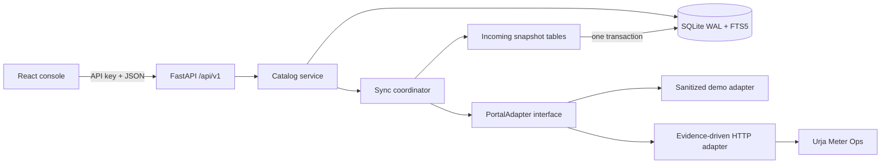

# Flock Energy / Urja Meter Ops API

This repository contains a read-only FastAPI service, a local SQLite index, and a React operations console for the Urja Meter Ops take-home. It exposes a stable JSON contract without requiring downstream users to navigate the legacy portal.

I have not yet investigated the live portal exchange. Demo mode is therefore the truthful default. The live adapter refuses to guess portal paths, session markers, units, or date semantics; those values are configuration-driven and remain `UNVERIFIED` in `PROTOCOL.md` until captured.

## Quick start

```bash
make install
cp .env.example .env
make api
make web
```

- Run `make api` and `make web` in separate terminals.
- Console: `http://127.0.0.1:5173`
- API: `http://127.0.0.1:8000`
- Interactive API documentation: `http://127.0.0.1:8000/docs`

## Product surface

- `/api/v1/meters`: server-side search, filters, pagination, bounding box, radius, and sorting.
- `/api/v1/meters/{id}`: canonical meter details with provenance and quality flags.
- `/api/v1/meters/{id}/consumption`: indexed readings with hour/day/month aggregation and summaries.
- `/api/v1/hierarchy`: reconstructed hierarchy with rollups, orphan nodes, cycles, and duplicate records preserved.
- `/api/v1/overview`, `/api/v1/quality`, `/api/v1/insights/signals`, `/api/v1/sync/status`, `/api/v1/metrics`.
- `/health` liveness and `/ready` dependency readiness.
- `/docs` and committed `openapi.json`.

The console includes:

- Overview.
- Meter explorer.
- Meter detail chart.
- Clustered spatial view.
- Hierarchy tree.
- Quality report.
- Command palette.
- Light/dark theme.
- Keyboard focus states.
- Stale, error, empty, loading, and reduced-motion behavior.

## Structure

```text
apps/api/app/{adapter,parsers,domain,store,services,api/v1,core}/
apps/api/tests/{unit,adapter,contract}/
apps/web/src/{app,components,features,lib}/
apps/web/tests/
apps/api/migrations/  fixtures/  tools/  docs/
README.md  PROTOCOL.md  REFLECTION.md  openapi.json  .env.example
```

- The adapter knows HTTP and portal payloads.
- Parsers are pure.
- The sync coordinator owns atomic snapshot refreshes, checkpoints, and task recovery.
- The catalog service owns freshness, indexed reads, coverage-aware aggregation, and signals.
- The API owns authentication and the public contract.
- The browser calls only same-origin API paths.

## Architecture



- The adapter owns transport, authentication, retry, circuit state, and parsing.
- The sync coordinator records a complete incoming snapshot, commits meters/readings/hierarchy atomically, records checkpoints and sync runs, and marks the last successful snapshot stale on failure.
- The catalog service owns indexed reads, coverage-aware consumption fetches, provenance, quality summaries, and signals.
- The web console only calls documented API routes.
- SQLite is appropriate for one local writer and modest catalog sizes.
- In-process aggregation, rate limiting, and sync single-flight are the first scale boundaries.
- A platform deployment would move the index to Postgres/PostGIS, retain canonical models, use durable incremental sync work, and share rate-limit state; this repository does not build those components.

## Fresh clone setup

Requirements:

- Python 3.11+.
- Node.js 18+.
- `uv`, installable with `pip install uv`. `make install` falls back to `python3 -m pip` when `uv` is unavailable.

```bash
git clone <repository-url>
cd FlockEnergy
make install
cp .env.example .env
make verify
```

`make install` installs the Python and web dependencies and installs the Playwright Chromium browser used by the browser suite.

Run the API:

```bash
source .venv/bin/activate
make api
```

Run the console in another terminal:

```bash
make web
```

The Vite development proxy adds the server-side read key to normal requests and uses the admin key only for `/api/v1/refresh`.

`API_READ_KEY`, `API_ADMIN_KEY`, `API_READ_KEYS`, `API_ADMIN_KEYS`, and `API_PROXY_TARGET` are read by Vite from the process environment or `.env`.

They are not placed in browser JavaScript.

In a production deployment, put the console and API behind the same origin.

Have the reverse proxy inject the read key for public API requests and the admin key for refresh controls.

## Assumptions

- The live portal exchange has not been investigated. Portal paths, session markers, units, and date semantics are configuration-driven and remain `UNVERIFIED` until captured.
- Units are not inferred or silently converted. `unknown_unit` is distinct from `missing`.
- Naive timestamps use the configured portal timezone and receive an `assumed_timezone` flag.
- The local service has one writer and one API instance. SQLite, in-process aggregation, rate limiting, and sync single-flight are sized for that use.
- The integration is read-only. Refresh uses the admin key, while normal reads use read keys.

## Design decisions and trade-offs

- **Adapter isolation:** The adapter owns HTTP transport, authentication, retries, circuit state, and portal payload handling. Parsers remain pure, so the API contract does not depend on portal navigation.
- **SQLite choice:** SQLite with WAL and FTS5 is appropriate for a local catalog and modest write volume. Many concurrent writers and multiple API instances are outside this deployment shape.
- **Provenance and quality flags:** Responses retain source and freshness information, while uncertainty such as missing values, unknown units, duplicate records, and timestamp issues remains visible.
- **Never-zero rule:** Missing values remain `null`; they never become zero. Aggregation returns `null` when nothing is summable or when units or reading kinds are incompatible.
- **Atomic sync with last-good snapshot:** Incoming snapshot tables are committed to canonical meters/readings/hierarchy in one transaction. A failed sync leaves the last successful snapshot untouched and marks it stale.
- **Read/admin keys:** Read operations and refresh operations use separate keys. Production refuses the local development keys and requires distinct read and admin keys.
- **Demo mode default:** The live portal exchange is unverified, so sanitized demo data is the truthful default. Live mode requires observed paths and an affirmative login signal.

## What I would improve with more time

- Capture and redact the live portal protocol exchange.
- Add a bulk path when the portal evidence supports one.
- Move the index to Postgres/PostGIS for a platform deployment.
- Add durable incremental sync work.
- Add shared observability for API, sync, freshness, and adapter behavior.
- Add more frontend tests around the console surfaces and user flows.

## Configuration

`.env.example` lists every setting.

Important local values:

```dotenv
APP_ENV=local
DEMO_MODE=true
API_READ_KEY=local-development-read-key
API_ADMIN_KEY=local-development-admin-key
DATABASE_URL=sqlite:///./flock_energy.db
ALLOWED_ORIGINS=http://localhost:5173,http://127.0.0.1:5173
TRUSTED_HOSTS=
MAX_REQUEST_BODY_BYTES=1048576
```

- Production refuses the local development keys and requires distinct read and admin keys.
- Portal credentials are environment-only.
- The integration is read-only.
- `ALLOWED_ORIGINS` controls browser origins accepted by the API.
- `TRUSTED_HOSTS` enables host-header validation when set; production requires it.
- `MAX_REQUEST_BODY_BYTES` limits incoming request bodies.

To enable live mode, first capture and redact the real browser exchange.

Then configure the observed paths and affirmative login signal:

```dotenv
DEMO_MODE=false
PORTAL_USERNAME=...
PORTAL_PASSWORD=...
PORTAL_LOGIN_PATH=...
PORTAL_METER_LIST_PATH=...
PORTAL_METER_DETAIL_PATH=...
PORTAL_CONSUMPTION_PATH=...
PORTAL_HIERARCHY_PATH=...
PORTAL_SESSION_COOKIE_NAME=...
PORTAL_LOGIN_PAGE_MARKERS=...
```

The adapter will not accept a successful login unless a configured session cookie or post-login marker is present.

It never uses an arbitrary URL word or a generic username/password page as an expiry signal.

Production also requires `DEMO_MODE=false`, an HTTPS `PORTAL_BASE_URL`, non-default distinct read and admin keys, and configured trusted hosts.

The API enforces request IDs, request-size limits, API-key authorization, configurable CORS origins, rate limiting, structured redacted logs, and optional trusted-host validation.

## Console screenshot

Screenshot placeholder: `docs/screenshot.png`.

Capture the running console after starting `make api` and `make web`, then save the image at that path. No image is included here.

## Example requests

List meters:

```bash
curl -H 'X-API-Key: local-development-read-key' \
  'http://127.0.0.1:8000/api/v1/meters?page=1&page_size=25&sort=name&order=asc'
```

The demo response has this shape; runtime timestamps are generated when the local index is written:

```json
{
  "data": [
    {
      "id": "MTR-1001",
      "serial_number": "URJA-1001",
      "name": "North feeder / A-01",
      "status": "active",
      "quality": {"flags": [], "issue_count": 0, "notes": []},
      "provenance": {"source": "demo", "stale": false, "age_seconds": 0}
    }
  ],
  "provenance": {"source": "index", "stale": false, "age_seconds": 0},
  "meta": {"page": 1, "page_size": 25, "total": 3, "has_next": false}
}
```

Read consumption with a documented aggregation level:

```bash
curl -H 'X-API-Key: local-development-read-key' \
  'http://127.0.0.1:8000/api/v1/meters/MTR-1001/consumption?granularity=day'
```

Refresh requires the admin key:

```bash
curl -X POST -H 'X-API-Key: local-development-admin-key' \
  'http://127.0.0.1:8000/api/v1/refresh'
```

## Data and quality rules

- Missing values remain `null`; they never become zero.
- Original timestamps and values are retained when normalization occurs.
- Naive timestamps use the configured portal timezone and receive an `assumed_timezone` flag.
- Locale ambiguity, unknown units, invalid values, duplicate IDs/readings, out-of-order readings, negative values, orphan nodes, cycles, mixed units, counter resets, and same-timestamp conflicts are visible in quality summaries.
- `unknown_unit` is distinct from `missing`, which is reserved for absent values.
- Hour, day, and month aggregation sums valid interval values in each bucket.
- Aggregation reports the bucket count and missing count.
- Aggregation returns `null` for mixed units, incompatible reading kinds, or buckets with nothing summable.
- Cumulative counters are converted to non-negative deltas only when configured.
- Counter resets are flagged and omitted.
- The API does not silently convert undocumented units.

## Storage, sync, and scale

- SQLite uses WAL, a migration table, FTS5, meter metadata, readings keyed by `(meter_id, timestamp)`, staging records, coverage ranges, checkpoints, reading conflict history, hierarchy records, dataset status, and sync run history.
- The conflict policy is latest-wins for the canonical row.
- Previous and incoming payloads are retained in `reading_conflicts`.
- The canonical row receives `conflict`.
- SQLite is appropriate for a local catalog and modest write volume.
- In-process aggregation and one-process rate limiting are the limits.
- Very large reading histories, many concurrent writers, or multiple API instances require Postgres/PostGIS, incremental cursors, a durable job queue, and a shared rate limiter.
- Startup sync runs once.
- A configured `SYNC_INTERVAL_SECONDS` starts a single background sync task with jitter.
- Reads serve indexed data immediately and schedule a background refresh when its configured TTL is exceeded.
- If an index has no data, the service uses the adapter as a live fallback and stores the result.
- A successful empty fetch is recorded as `data_status=empty`.
- A failed sync leaves the last successful snapshot untouched and marks it stale.

## Tests and checks

```bash
make verify
```

`make verify` runs:

- Python lint.
- Strict type check.
- Python tests with coverage.
- Lockfile consistency check.
- OpenAPI drift check.
- Generated API type check.
- Vitest.
- Web lint.
- Production build.
- Playwright browser suite.

Individual frontend commands:

```bash
cd apps/web
npm run test
npm run test:repeat
npm run test:watch
npm run smoke
```

CI runs the same checks and uses a temporary SQLite database for browser verification.

The mock portal in `tools/mock_portal` replays sanitized fixtures and supports:

- Session expiry.
- Login-page responses with status 200.
- 401 login rejection.
- 404, 429, 500, and 503 with `Retry-After`.
- Slow responses.
- Malformed responses.

`tools/sanitize_fixtures/main.py` removes secret-key values and email-shaped values from JSON fixtures.

## Known limitations

- Live portal behavior remains unverified. The exact routes, selectors, cookies, and request parameters have not been captured.
- No live portal test, bulk protocol claim, or unsupported portal field is included while the portal exchange remains unverified.
- No bulk export is used because its existence was not observed.
- Closed historical periods have storage support but no immutable-period policy beyond the configured zero-TTL default; the real portal evidence should establish that policy.
- The local product supports one local writer and one API instance.
- In-process aggregation, bounded in-process rate limiting, and sync single-flight do not provide distributed coordination.
- Many concurrent writers, very large reading histories, or multiple API instances require Postgres/PostGIS, incremental cursors, a durable job queue, and a shared rate limiter.
- Browser smoke execution requires the local API and Vite dev server; its exact status is recorded in `docs/verification.md`.
- No ML anomaly model is included.
- Local tests cover the parser shapes, fault injection paths, API contract, property boundaries, frontend components, and browser flows; the live portal exchange is not covered.

## Intentional omissions

- Exact live portal routes, selectors, cookies, and request parameters are not committed because they have not yet been captured.
- No bulk export is used because its existence was not observed.
- A distributed deployment layer is not included: the local product uses SQLite and bounded in-process rate limiting by design.
- No Postgres/PostGIS migration, durable queue, multi-instance rate limiter, or multi-tenant model is included; the platform path is documented without building those components.
- No ML anomaly model or unsupported portal field is included while the portal exchange remains unverified.

## Documentation

- [Protocol record](PROTOCOL.md)
- [Reflection](REFLECTION.md)
- [Architecture](docs/architecture.md)
- [Freshness rules](docs/freshness.md)
- [Platform path](docs/platform-path.md)
- [Backup and restore](docs/backup-restore.md)
- [Portal capture worksheet](docs/recon-worksheet.md)
- [Browser capture instructions](docs/recon-capture.md)
- [Sanitized portal notes](docs/recon-notes.md)
- [Interview walkthrough](docs/walkthrough.md)
- [SQLite benchmark](docs/benchmark.md)
- [Suggested conventional commits](docs/commit-sequence.md)
- [Verification record](docs/verification.md)
- [OpenAPI contract](openapi.json)
