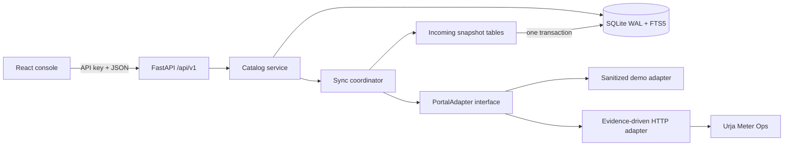

# Architecture

The adapter owns transport, authentication, retry, circuit state, and parsing. The sync coordinator records a complete incoming snapshot, commits meters/readings/hierarchy atomically, records checkpoints and sync runs, and marks the last successful snapshot stale on failure. The catalog service owns indexed reads, coverage-aware consumption fetches, provenance, quality summaries, and signals. The web console only calls documented API routes.

SQLite is appropriate for one local writer and modest catalog sizes. In-process aggregation, rate limiting, and sync single-flight are the first scale boundaries. A platform deployment would move the index to Postgres/PostGIS, retain canonical models, use durable incremental sync work, and share rate-limit state; this repository does not build those components.
