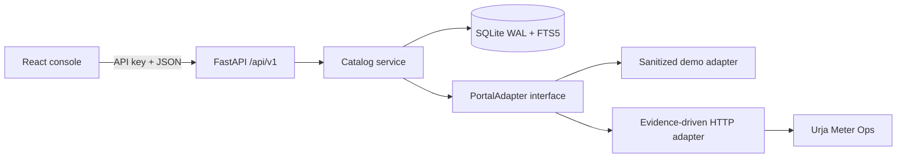

# Architecture

The adapter owns transport, authentication, retry, and parsing. The service owns the public contract, local index access, provenance, and summaries. The web console only calls documented API routes.
